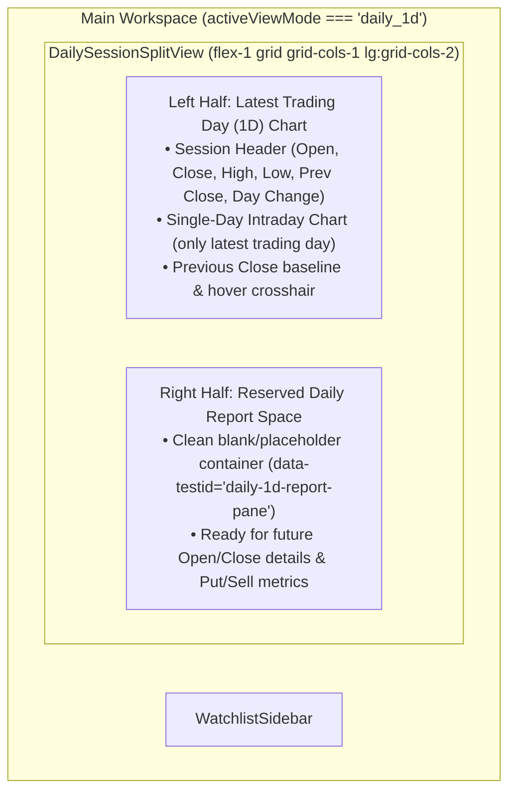

# Vertical Slice Specification: Milestone 17 — Dedicated 1D Latest Trading Day Split View & Reserved Daily Report Space (`milestone-17-daily-1d-split-view-and-report-space`)

## 1. Slice Scope & Architectural Invariants Check

### 1.1 Problem Statement & UX Goals
1. **Why a Dedicated Split View for `1D` ("Last Night's Price" / Latest Trading Day)**:
   - Multi-month historical charts (`1W`, `1M`, `3M`, `6M`, `1Y`) benefit from a full-width horizontal canvas so users can pan across months of candles and draw trendlines.
   - By contrast, a single trading session (`1D`) covers a fixed single-day horizon. Stretching a single day across an entire ultrawide window wastes horizontal space, whereas traders inspecting a single day need session-level context (Open, Close, High, Low, Previous Close, Volume, and future microstructure metrics like Put/Call or Buy/Sell flow) right beside the intraday trajectory.
2. **Repurpose the `1D` Time Scope Button to Launch the Split View**:
   - Clicking **`1D`** on the `TopHeaderBar` time scope bar (or pressing keyboard shortcut `1`) switches the main workspace area into a dedicated **50 / 50 Split View** (`WorkspaceViewMode = 'daily_1d'`):
     - **Left Half (`50%` width)**: A dedicated **Latest Trading Day (`1D`) Chart** that plots *only* the price trajectory and change from the **latest trading day** (with session Open, Close, High, Low, Previous Close baseline, and net change readout).
     - **Right Half (`50%` width)**: A reserved **Daily Report Panel** container, intentionally left blank for now so future daily report widgets (Open/Close breakdown, Put/Call & Buy/Sell volume numbers, order flow) can be slotted in cleanly.
   - Clicking any multi-day scope button (**`1W`**, **`1M`**, **`3M`**, **`6M`**, **`1Y`**, or pressing shortcuts `2`–`6`, or clicking `"Back to Historical Chart"`) switches back to the full-width **Historical Chart View** (`WorkspaceViewMode = 'historical'`).
   - Selecting a different stock in the `WatchlistSidebar` while in the `1D` Split View stays in the `1D` Split View and immediately updates the left-half `1D` chart for the newly selected ticker.
3. **Defer Live Opening-Hours Streaming (`TODO`)**:
   - Do **not** implement live opening-hours streaming or tick-by-tick updates during active market hours in this slice. Leave explicit `TODO(opening-hours-live-update)` markers in the headless core session extractor and `DailySessionSplitView` component.

---

### 1.2 Architectural Invariants Check
- [x] **Zero DOM/UI imports in `src/core/`**: Confirmed. `WorkspaceViewModeSchema`, `LatestTradingDaySessionSchema`, and `extractLatestTradingDaySession` in `src/core/schemas/market.ts` use pure TypeScript and Zod with zero DOM, React, or `lightweight-charts` imports.
- [x] **All external market data flows through `MarketDataProvider`**: Confirmed. `extractLatestTradingDaySession` derives the latest trading session strictly from normalized `OHLCVCandle[]` (`dailyCandles` + `intradayCandles`) and `TickerQuote` already fetched via `MarketDataProvider` / `CachedMarketDataProvider`.
- [x] **All chart overlays use logical `{ timestamp, price }` coordinates and register via `ChartOverlayPlugin`**: Confirmed. The historical `ChartContainer` and its overlay plugin engine remain untouched when in `'historical'` mode, and switching to `'daily_1d'` preserves the historical chart's custom viewing scope for when the user returns.

---

## 2. Headless Core Contracts (`src/core/`)

### 2.1 Workspace View Mode & Latest Trading Day Session Schema (`src/core/schemas/market.ts`)

Add `WorkspaceViewModeSchema`, `LatestTradingDaySessionSchema`, and the pure session extractor `extractLatestTradingDaySession` in `src/core/schemas/market.ts`:

```typescript
/**
 * Workspace view mode:
 * - 'historical': Full-width multi-day candlestick/price chart (1W, 1M, 3M, 6M, 1Y)
 * - 'daily_1d': 50/50 split view with Latest Trading Day chart on the left and Daily Report space on the right
 */
export const WorkspaceViewModeSchema = z.enum(['historical', 'daily_1d']);
export type WorkspaceViewMode = z.infer<typeof WorkspaceViewModeSchema>;

/**
 * Normalized snapshot of the latest trading day's price session ("last night's price")
 * for the dedicated 1D Split View.
 *
 * TODO(opening-hours-live-update): Support real-time streaming updates during active market
 * opening hours. Currently represents a static snapshot of the latest trading day.
 */
export const LatestTradingDaySessionSchema = z.object({
  ticker: TickerSymbolSchema,
  /** Unix timestamp (seconds UTC) of the latest daily bar */
  sessionDateTimestamp: z.number().int().positive(),
  /** Opening price of the latest trading day */
  open: z.number().finite().nonnegative(),
  /** Closing (or latest) price of the latest trading day */
  close: z.number().finite().nonnegative(),
  /** Intraday high of the latest trading day */
  high: z.number().finite().nonnegative(),
  /** Intraday low of the latest trading day */
  low: z.number().finite().nonnegative(),
  /** Previous trading day's close price used as the daily change reference baseline */
  previousClose: z.number().finite().nonnegative(),
  /** Net dollar change vs previousClose (close - previousClose) */
  change: z.number().finite(),
  /** Percentage change vs previousClose (((close - previousClose) / previousClose) * 100) */
  changePercent: z.number().finite(),
  /** Net dollar change from session open to close (close - open) */
  openToCloseChange: z.number().finite(),
  /** Percentage change from session open to close (((close - open) / open) * 100) */
  openToCloseChangePercent: z.number().finite(),
  /** Total share volume traded on the latest trading day */
  volume: z.number().finite().nonnegative(),
  /** Chronological intraday OHLCV bars covering ONLY the latest trading day */
  bars: z.array(OHLCVCandleSchema).min(1),
});
export type LatestTradingDaySession = z.infer<typeof LatestTradingDaySessionSchema>;
```

### 2.2 Pure Session Extractor (`extractLatestTradingDaySession` in `src/core/schemas/market.ts`)

```typescript
/**
 * Extracts a normalized `LatestTradingDaySession` covering ONLY the latest trading day
 * from historical daily candles, optional 15-minute intraday candles, and optional quote.
 *
 * - Filters `intradayCandles` to the UTC day bucket of the latest trading session.
 * - If fewer than 2 intraday bars exist for that day, deterministically synthesizes a
 *   16-bar (15-minute interval) single-session trajectory anchored to the latest daily
 *   candle's { open, high, low, close, volume } so the 1D chart always renders a
 *   complete single-day curve.
 * - TODO(opening-hours-live-update): Do not dynamically stream/append partial opening-hour
 *   ticks yet; treat the session as a static latest-trading-day snapshot.
 */
export function extractLatestTradingDaySession(
  ticker: string,
  dailyCandles: ReadonlyArray<OHLCVCandle>,
  intradayCandles: ReadonlyArray<OHLCVCandle> = [],
  quote?: TickerQuote
): LatestTradingDaySession | null
```

Re-export `WorkspaceViewModeSchema`, `type WorkspaceViewMode`, `LatestTradingDaySessionSchema`, `type LatestTradingDaySession`, and `extractLatestTradingDaySession` from `src/core/index.ts`.

---

## 3. UI & Chart Plugin Layer (`src/features/` & `src/ui/`)

### 3.1 Dedicated `1D` Split View Component (`src/features/chart/DailySessionSplitView.tsx`)
Create `src/features/chart/DailySessionSplitView.tsx` to render the two-column `1D` page when `activeViewMode === 'daily_1d'`:



1. **Props (`DailySessionSplitViewProps`)**:
   ```typescript
   export interface DailySessionSplitViewProps {
     ticker: string;
     dailyCandles: OHLCVCandle[];
     intradayCandles?: OHLCVCandle[];
     quote?: TickerQuote;
     isLoading?: boolean;
     onBackToHistoricalChart?: () => void;
   }
   ```
2. **Left Half (`data-testid="daily-1d-chart-pane"`)**:
   - **Session Summary Strip**:
     - Displays `{ticker}`, `"Latest Trading Day (1D)"` badge, formatted session date (`YYYY-MM-DD`), and a `"← Historical Chart"` return button (`data-testid="daily-1d-back-btn"`).
     - Displays key session numbers in a scannable bar:
       - `Open`: `${session.open.toFixed(2)}` (`data-testid="daily-1d-open"`)
       - `Close`: `${session.close.toFixed(2)}` (`data-testid="daily-1d-close"`)
       - `High`: `${session.high.toFixed(2)}` (`data-testid="daily-1d-high"`)
       - `Low`: `${session.low.toFixed(2)}` (`data-testid="daily-1d-low"`)
       - `Prev Close`: `${session.previousClose.toFixed(2)}` (`data-testid="daily-1d-prev-close"`)
       - `Change`: `${change >= 0 ? '+' : ''}${session.change.toFixed(2)} (${session.changePercent >= 0 ? '+' : ''}${session.changePercent.toFixed(2)}%)` (`data-testid="daily-1d-change"`)
   - **Single-Day Intraday Chart**:
     - Renders ONLY `session.bars` (the latest trading day's intraday bars) so the X-axis spans exclusively the latest trading session from open to close.
     - Plots a smooth intraday price curve + gradient fill colored emerald (`#10b981`) when `session.close >= session.previousClose` or rose (`#f43f5e`) when `session.close < session.previousClose`, plus a horizontal dashed reference baseline at `session.previousClose` (`Prev Close`) and `session.open` (`Open`).
     - Interactive mouse hover crosshair displays the exact intraday time (`HH:MM UTC`), price, and delta vs `previousClose` at any point along the latest trading day.
3. **Right Half (`data-testid="daily-1d-report-pane"`)**:
   - Occupies the right `50%` of the split view (`flex-1 border-l border-slate-800/80 bg-slate-950 p-6`).
   - Left intentionally blank / unpopulated with a subtle minimal container (`data-testid="daily-1d-report-placeholder"`) so future daily report modules (e.g., detailed Open/Close auction breakdown, Put/Call & Buy/Sell order flow) can be added without restructuring the layout.
   - Includes `// TODO(opening-hours-live-update): Keep 1D view as static latest trading day snapshot for now; live opening-hours streaming to be added in a future slice.`

### 3.2 Wiring `1D` Action in `src/App.tsx` & `src/ui/layout/TopHeaderBar.tsx`
1. In `src/App.tsx`:
   - Add state:
     ```typescript
     const [activeViewMode, setActiveViewMode] = useState<WorkspaceViewMode>('historical');
     ```
   - Initial website launch remains `DEFAULT_INITIAL_TIMEFRAME` (`'3M'`) in `'historical'` view mode.
   - When the user clicks a time scope button in `TopHeaderBar` (`onSelectTimeframe(tf)`) or presses keyboard shortcuts `1`–`6`:
     - **If `tf === '1D'`**:
       - Set `setActiveViewMode('daily_1d')`.
       - Do **not** increment `focusRevision` or overwrite the historical chart's `viewingLogicalRangeRef`, so when the user returns to `'historical'` view, their previous historical zoom/pan scope remains intact!
     - **If `tf !== '1D'` (`'1W' | '1M' | '3M' | '6M' | '1Y'`)**:
       - Set `setActiveViewMode('historical')`.
       - Increment `setFocusRevision((rev) => rev + 1)` and call `void marketStore.getState().setActiveTimeframe(tf)`.
   - In `<main className="relative flex flex-1 overflow-hidden">`:
     - When `activeViewMode === 'daily_1d'`, render `<DailySessionSplitView ... />` beside `<WatchlistSidebar />`.
     - When `activeViewMode === 'historical'`, render `<ChartContainer ... />` beside `<WatchlistSidebar />`.

---

## 4. Ordered File Manifest

1. `[MODIFY]` [market.ts](file:///home/duke/Project/marketview/src/core/schemas/market.ts)
   - Add `WorkspaceViewModeSchema`, `WorkspaceViewMode`, `LatestTradingDaySessionSchema`, `LatestTradingDaySession`, and `extractLatestTradingDaySession`.
2. `[MODIFY]` [index.ts](file:///home/duke/Project/marketview/src/core/index.ts)
   - Re-export the new schemas, types, and helper from `./schemas/market`.
3. `[NEW]` [DailySessionSplitView.tsx](file:///home/duke/Project/marketview/src/features/chart/DailySessionSplitView.tsx)
   - Implement the 50/50 split view with the dedicated Latest Trading Day (`1D`) chart on the left half and the blank reserved Daily Report space on the right half (plus `TODO` for opening-hours live updates).
4. `[MODIFY]` [App.tsx](file:///home/duke/Project/marketview/src/App.tsx)
   - Wire `activeViewMode` (`'historical' | 'daily_1d'`) so clicking `1D` (or pressing `1`) launches `DailySessionSplitView`, while clicking `1W`–`1Y` (or pressing `2`–`6`) shows `ChartContainer`.
5. `[NEW]` [daily-session-split-view.test.ts](file:///home/duke/Project/marketview/src/features/chart/__tests__/daily-session-split-view.test.ts)
   - Unit and rendering tests for `extractLatestTradingDaySession` and `DailySessionSplitView`.

---

## 5. Verification & Test Matrix

1. **Headless Core Unit Tests (`src/features/chart/__tests__/daily-session-split-view.test.ts`)**:
   - `extractLatestTradingDaySession` extracts only the latest trading day's intraday bars when multi-day `15m` candles are provided.
   - `extractLatestTradingDaySession` synthesizes a 16-bar single-session curve matching the latest daily candle's `{ open, high, low, close }` when `intradayCandles` is empty.
   - Computes accurate `previousClose`, `change`, `changePercent`, `openToCloseChange`, and `openToCloseChangePercent`.
   - Returns `null` when `dailyCandles` is empty.
2. **UI Split View Rendering Tests (`src/features/chart/__tests__/daily-session-split-view.test.ts`)**:
   - `DailySessionSplitView` renders both the left-half chart pane (`data-testid="daily-1d-chart-pane"`) with Open, Close, High, Low, Prev Close, and Change readouts, and the right-half blank reserved Daily Report pane (`data-testid="daily-1d-report-pane"` / `data-testid="daily-1d-report-placeholder"`).
3. **Typecheck & Regression Suite**:
   - `npm run typecheck` (`tsc --noEmit`) passes with zero errors.
   - `npm run test` (`vitest run`) passes all test files with zero regressions.
