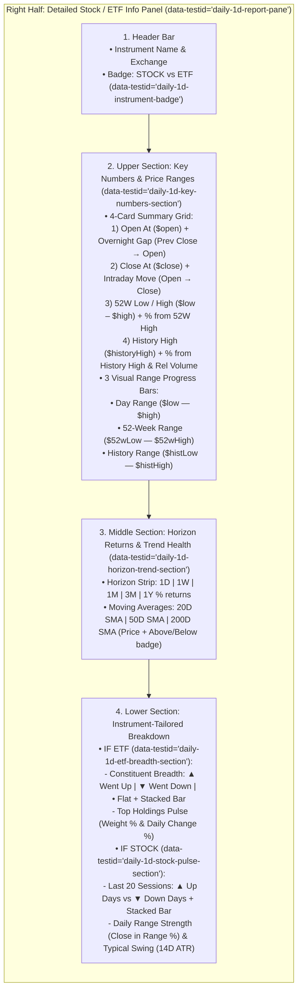

# Vertical Slice Specification: Milestone 18 — Right Split Panel Detailed Stock & ETF Report (`milestone-18-right-split-panel-detailed-info`)

## 1. Slice Scope & Architectural Invariants Check

### 1.1 Problem Statement & UX Goals
1. **Why Populate the Right Split Panel (`1D` View) with Minimal, Scannable Context**:
   - In Milestone 17, clicking **`1D`** (or pressing `1`) opens `DailySessionSplitView`: the left 50% renders the single-day intraday price trajectory, while the right 50% (`data-testid="daily-1d-report-pane"`) was reserved as a placeholder.
   - Users inspecting a stock or ETF on the `1D` split view shouldn't have to decipher Wall Street jargon or dig through cluttered tables. Following MarketView's core design principle (**minimal, simple, easy to use**), the right panel should answer three immediate questions at a glance:
     1. **Upper Section — Key Numbers & Where Price Sits Today**:
        - **Open / Close & Session Split**: What price did it **Open at** and **Close at**? How much of today's move happened at the opening bell (**Overnight Gap**: `Prev Close → Open`) vs. during active trading (**Intraday Move**: `Open → Close`)?
        - **Key High/Low Benchmarks & Visual Range Bars**: Where does the current price sit within **Today's Low/High**, the **52-Week Low/High**, and the **History High (All-Time / Multi-Month Peak)**?
        - **Volume Context**: Is today's trading volume heavy, normal, or light compared to its **20-Day Average Volume**?
     2. **Middle Section — Multi-Horizon Returns & Simple Trend Health**:
        - **Horizon Returns Strip (`1D`, `1W`, `1M`, `3M`, `1Y`)**: A single row of 5 pills showing how today's move fits into the broader week, month, quarter, and year.
        - **Key Moving Averages (`20D`, `50D`, `200D SMA`)**: Three clean benchmarks showing whether the price is trading **Above** or **Below** its short-, medium-, and long-term trend lines.
     3. **Lower Section — Instrument-Tailored Pulse (ETF vs. Individual Stock)**:
        - **For ETFs (`SPY`, `QQQ`, `DIA`, `IWM`, `VOO`, `XLK`, etc.)**:
          - **Market Breadth (How Many Stocks Went Up vs. Down)**: Displays the exact count and percentage of constituent stocks that **Went Up (Advancing)**, **Went Down (Declining)**, and stayed **Flat**, paired with a single **emerald/rose stacked breadth bar** and a compact **Top Holdings Pulse** (top 5 constituent weights and their daily `%` change).
        - **For Individual Stocks (`AAPL`, `NVDA`, `MSFT`, `TSLA`, etc.)**:
          - **20-Session Win Rate (Up vs. Down Days)**: Displays how many of the last 20 trading days closed **Up** vs. **Down** (with the same intuitive green/red stacked bar).
          - **Daily Range & Volatility Context**: Shows **Where It Closed in Today's Range** (`0%` = day's low, `100%` = day's high, with plain-English labels like `"Strong Close Near High"`) and **Typical Daily Swing (`14D ATR`)** (`$X.XX` / `X.X%`, plus whether today's swing is wider or calmer than normal).

---

### 1.2 Architectural Invariants Check
- [x] **Zero DOM/UI imports in `src/core/`**: Confirmed. All report schemas (`InstrumentTypeSchema`, `PriceRangeSummarySchema`, `EtfBreadthSummarySchema`, `StockSessionPulseSchema`, `TickerDetailedReportSchema`) and the pure calculator (`buildTickerDetailedReport`) live in `src/core/schemas/market.ts` using pure TypeScript and Zod with zero DOM, React, or `lightweight-charts` imports.
- [x] **All external market data flows through `MarketDataProvider`**: Confirmed. `buildTickerDetailedReport` computes all range benchmarks, moving averages, volume ratios, and breadth metrics purely from normalized `OHLCVCandle[]` and `TickerQuote` records already fetched through `MarketDataProvider` / `CachedMarketDataProvider`.
- [x] **All chart overlays use logical `{ timestamp, price }` coordinates and register via `ChartOverlayPlugin`**: Confirmed. The historical `ChartContainer` and overlay plugin system remain untouched.

---

## 2. Headless Core Contracts (`src/core/`)

### 2.1 Detailed Stock & ETF Report Schemas (`src/core/schemas/market.ts`)

Add the following Zod schemas and inferred TypeScript types to `src/core/schemas/market.ts`:

```typescript
/**
 * Classification of the active instrument for tailoring the 1D right split panel:
 * - 'stock': Individual company equity (e.g., AAPL, NVDA, MSFT, TSLA)
 * - 'etf': Exchange-Traded Fund / Index basket (e.g., SPY, QQQ, DIA, IWM, VOO)
 */
export const InstrumentTypeSchema = z.enum(['stock', 'etf']);
export type InstrumentType = z.infer<typeof InstrumentTypeSchema>;

/**
 * Normalized low/high range benchmark with current price position percentage (0..100)
 * and percentage distance from the range high and low.
 */
export const PriceRangeSummarySchema = z.object({
  low: z.number().finite().nonnegative(),
  high: z.number().finite().nonnegative(),
  current: z.number().finite().nonnegative(),
  /** Clamped 0..100 position of `current` between `low` (0%) and `high` (100%) */
  positionPercent: z.number().finite().min(0).max(100),
  /** Percentage difference from `high`: ((current - high) / high) * 100 (<= 0 when below high) */
  distanceFromHighPercent: z.number().finite(),
  /** Percentage difference above `low`: ((current - low) / low) * 100 (>= 0 when above low) */
  distanceFromLowPercent: z.number().finite(),
});
export type PriceRangeSummary = z.infer<typeof PriceRangeSummarySchema>;

/**
 * Single horizon return pill item for the multi-period return strip.
 */
export const PeriodReturnItemSchema = z.object({
  label: z.enum(['1D', '1W', '1M', '3M', '1Y']),
  changePercent: z.number().finite(),
});
export type PeriodReturnItem = z.infer<typeof PeriodReturnItemSchema>;

/**
 * Simple Moving Average (SMA) trend benchmark for quick trend health inspection.
 */
export const MovingAverageBenchmarkSchema = z.object({
  period: z.union([z.literal(20), z.literal(50), z.literal(200)]),
  label: z.string().min(1),
  price: z.number().finite().nonnegative(),
  /** Percentage distance of current close vs SMA: ((close - sma) / sma) * 100 */
  distancePercent: z.number().finite(),
  isAbove: z.boolean(),
});
export type MovingAverageBenchmark = z.infer<typeof MovingAverageBenchmarkSchema>;

/**
 * Top constituent holding entry inside an ETF summary.
 */
export const EtfConstituentDriverSchema = z.object({
  ticker: TickerSymbolSchema,
  name: z.string().min(1),
  weightPercent: z.number().finite().positive(),
  changePercent: z.number().finite(),
});
export type EtfConstituentDriver = z.infer<typeof EtfConstituentDriverSchema>;

/**
 * ETF constituent breadth (how many stocks went up vs. down) and top holdings snapshot.
 */
export const EtfBreadthSummarySchema = z.object({
  indexLabel: z.string().min(1),
  totalCount: z.number().int().positive(),
  advancingCount: z.number().int().nonnegative(),
  decliningCount: z.number().int().nonnegative(),
  unchangedCount: z.number().int().nonnegative(),
  advancingPercent: z.number().finite().min(0).max(100),
  decliningPercent: z.number().finite().min(0).max(100),
  unchangedPercent: z.number().finite().min(0).max(100),
  topHoldings: z.array(EtfConstituentDriverSchema),
});
export type EtfBreadthSummary = z.infer<typeof EtfBreadthSummarySchema>;

/**
 * Individual stock 20-day up/down session pulse & daily volatility breakdown.
 */
export const StockSessionPulseSchema = z.object({
  lookbackDays: z.number().int().positive(),
  upDaysCount: z.number().int().nonnegative(),
  downDaysCount: z.number().int().nonnegative(),
  flatDaysCount: z.number().int().nonnegative(),
  upDaysPercent: z.number().finite().min(0).max(100),
  downDaysPercent: z.number().finite().min(0).max(100),
  /** 14-day Average True Range in dollars */
  atr14: z.number().finite().nonnegative(),
  /** 14-day Average True Range as a percentage of current close */
  atr14Percent: z.number().finite().nonnegative(),
  /** Ratio of today's (high - low) vs atr14 (e.g., 1.25 means 1.25x typical daily range) */
  todayRangeRatioVsAtr: z.number().finite().nonnegative(),
  /** 0..100 position of today's close within today's low-high range */
  closeLocationPercent: z.number().finite().min(0).max(100),
  closeStrengthLabel: z.enum([
    'Strong Close Near High',
    'Mid-Range Close',
    'Weak Close Near Low',
  ]),
});
export type StockSessionPulse = z.infer<typeof StockSessionPulseSchema>;

/**
 * Complete headless report model for the 1D Right Split Panel.
 */
export const TickerDetailedReportSchema = z.object({
  ticker: TickerSymbolSchema,
  name: z.string().min(1),
  exchange: z.string().min(1),
  instrumentType: InstrumentTypeSchema,
  sessionDateTimestamp: z.number().int().positive(),
  // Core Session Numbers
  open: z.number().finite().nonnegative(),
  close: z.number().finite().nonnegative(),
  high: z.number().finite().nonnegative(),
  low: z.number().finite().nonnegative(),
  previousClose: z.number().finite().nonnegative(),
  change: z.number().finite(),
  changePercent: z.number().finite(),
  /** Overnight gap from previous close to today's open (open - previousClose) */
  overnightGap: z.number().finite(),
  overnightGapPercent: z.number().finite(),
  /** Regular session move from today's open to close (close - open) */
  openToCloseChange: z.number().finite(),
  openToCloseChangePercent: z.number().finite(),
  // Range Benchmarks (Day, 52-Week, History High/Low)
  dayRange: PriceRangeSummarySchema,
  week52Range: PriceRangeSummarySchema,
  historyHigh: z.number().finite().nonnegative(),
  historyLow: z.number().finite().nonnegative(),
  historyRange: PriceRangeSummarySchema,
  // Volume Context
  volume: z.number().finite().nonnegative(),
  avgVolume20d: z.number().finite().nonnegative(),
  relativeVolume: z.number().finite().nonnegative(),
  volumeStatusLabel: z.enum(['High Volume', 'Normal Volume', 'Light Volume']),
  // Multi-Horizon Returns & Moving Averages
  periodReturns: z.array(PeriodReturnItemSchema),
  movingAverages: z.array(MovingAverageBenchmarkSchema),
  // Tailored Lower Section (mutually exclusive by instrumentType)
  etfBreadth: EtfBreadthSummarySchema.nullable(),
  stockPulse: StockSessionPulseSchema.nullable(),
});
export type TickerDetailedReport = z.infer<typeof TickerDetailedReportSchema>;
```

### 2.2 Pure Detailed Report Builder (`buildTickerDetailedReport` in `src/core/schemas/market.ts`)

```typescript
/**
 * Pure, deterministic builder that computes a `TickerDetailedReport` from
 * historical daily candles, optional intraday candles, optional active quote,
 * and optional watchlist quotes map (used to enrich ETF top holdings when available).
 */
export function buildTickerDetailedReport(
  rawTicker: string,
  dailyCandles: ReadonlyArray<OHLCVCandle>,
  intradayCandles: ReadonlyArray<OHLCVCandle> = [],
  quote?: TickerQuote,
  quotesByTicker?: Readonly<Record<string, TickerQuote>>
): TickerDetailedReport | null
```

#### Calculation Rules in `buildTickerDetailedReport`:
1. **Session Baseline**:
   - Calls `extractLatestTradingDaySession(rawTicker, dailyCandles, intradayCandles, quote)` first. Returns `null` if `session` is `null`.
   - Computes `overnightGap = round2(session.open - session.previousClose)` and `overnightGapPercent = session.previousClose > 0 ? round2((overnightGap / session.previousClose) * 100) : 0`.
2. **Instrument Detection (`stock` vs. `etf`)**:
   - Known ETF metadata catalog (`SPY`, `QQQ`, `DIA`, `IWM`, `VOO`, `VTI`, `SOXX`, `SMH`, `XLK`, `XLF`, `XLE`, `XLV`, `XLI`, `XLP`, `XLU`, `XLY`, `XLC`, `XLB`, `XLRE`, `ARKK`, `TLT`, `GLD`, `SLV`, `IBIT`) with constituent count (`totalCount`, e.g., `500` for `SPY`/`VOO`, `100` for `QQQ`, `30` for `DIA`, `2000` for `IWM`, etc.), `indexLabel` (e.g., `"S&P 500 Constituents"`, `"Nasdaq-100 Constituents"`), and top 5 holdings (`ticker`, `name`, `weightPercent`).
   - Any other ticker defaults to `instrumentType = 'stock'` (with metadata catalog names for `AAPL`, `NVDA`, `MSFT`, `AMZN`, `GOOGL`, `META`, `TSLA`, `AMD`, and fallback `${ticker} Corp.` / `US`).
3. **Range Benchmarks (`dayRange`, `week52Range`, `historyRange`)**:
   - `dayRange`: `low = session.low`, `high = session.high`, `current = session.close`.
   - `week52Range`: Computed across the trailing `Math.min(252, sortedDaily.length)` daily candles combined with `session.low` and `session.high`.
   - `historyRange`: Computed across all `sortedDaily` candles combined with `week52Range` and an optional reference all-time high floor from the metadata catalog so `historyHigh >= week52Range.high >= dayRange.high` is strictly guaranteed.
4. **Volume Context**:
   - `avgVolume20d`: Mean volume of the trailing `Math.min(20, sortedDaily.length)` daily bars (fallback to `session.volume` if 0).
   - `relativeVolume`: `round2(session.volume / avgVolume20d)`.
   - `volumeStatusLabel`: `'High Volume'` if `relativeVolume >= 1.25`, `'Light Volume'` if `relativeVolume <= 0.75`, else `'Normal Volume'`.
5. **Horizon Returns (`1D`, `1W`, `1M`, `3M`, `1Y`) & Moving Averages (`SMA 20`, `SMA 50`, `SMA 200`)**:
   - `1D`: `session.changePercent`.
   - `1W` (5 trading days back), `1M` (21 trading days back), `3M` (63 trading days back), `1Y` (252 trading days back, or earliest loaded bar if fewer): `round2(((session.close - refBar.close) / refBar.close) * 100)`.
   - `movingAverages`: Computes simple arithmetic mean of `close` for trailing `20`, `50`, and `200` bars (using `Math.min(period, sortedDaily.length)` bars so even shorter series produce valid benchmarks).
6. **ETF Constituent Breadth (`instrumentType === 'etf'`)**:
   - Deterministically computes `advancingCount`, `decliningCount`, and `unchangedCount` summing to `totalCount`:
     - Uses a bounded logistic curve driven by `session.changePercent` and `session.openToCloseChangePercent` (`effectiveShift = session.changePercent * 0.75 + session.openToCloseChangePercent * 0.25`):
       - `unchangedRatio` between `1%` and `3%` of `totalCount`.
       - `upShare = clamp(0.08, 0.92, 0.5 + Math.tanh(effectiveShift * 0.65) * 0.42)`.
       - `advancingCount = Math.round((totalCount - unchangedCount) * upShare)`.
       - `decliningCount = totalCount - unchangedCount - advancingCount`.
     - For `topHoldings`: Uses `quotesByTicker[holding.ticker]?.changePercent` when available; otherwise derives a deterministic session return correlated with `session.changePercent`.
7. **Individual Stock Session Pulse (`instrumentType === 'stock'`)**:
   - `lookbackDays = Math.min(20, sortedDaily.length)`.
   - Counts `upDaysCount` (`bar.close > prevClose`), `downDaysCount` (`bar.close < prevClose`), and `flatDaysCount` over the trailing `lookbackDays`.
   - Computes 14-day Average True Range (`atr14` and `atr14Percent`), `todayRangeRatioVsAtr = atr14 > 0 ? round2((session.high - session.low) / atr14) : 1`, and `closeLocationPercent = dayRange.positionPercent` (`>= 67` → `'Strong Close Near High'`, `<= 33` → `'Weak Close Near Low'`, else `'Mid-Range Close'`).

Re-export all new schemas, types, and `buildTickerDetailedReport` from `src/core/index.ts`.

---

## 3. UI & Chart Plugin Layer (`src/features/` & `src/ui/`)

### 3.1 Right Split Panel Layout (`src/features/chart/DailySessionSplitView.tsx`)



1. **Props Update (`DailySessionSplitViewProps` in `src/features/chart/DailySessionSplitView.tsx`)**:
   ```typescript
   export interface DailySessionSplitViewProps {
     ticker: string;
     dailyCandles: OHLCVCandle[];
     intradayCandles?: OHLCVCandle[];
     quote?: TickerQuote;
     quotesByTicker?: Record<string, TickerQuote>;
     isLoading?: boolean;
     onBackToHistoricalChart?: () => void;
   }
   ```
2. **Pass `quotesByTicker` from `src/App.tsx`**:
   - In `src/App.tsx`, pass `quotesByTicker={quotesByTicker}` to `<DailySessionSplitView ... />`.
3. **Key Test IDs & Minimalist Visual Elements in `DailySessionSplitView.tsx`**:
   - Container: `data-testid="daily-1d-report-pane"`
   - Instrument badge (`STOCK` or `ETF`): `data-testid="daily-1d-instrument-badge"`
   - **Upper Section (`data-testid="daily-1d-key-numbers-section"`)**:
     - Open & Overnight Gap card: `data-testid="daily-1d-report-open-card"`
     - Close & Intraday Move card: `data-testid="daily-1d-report-close-card"`
     - 52-Week Low / High card: `data-testid="daily-1d-report-52w-card"` (displays both `52W Low` and `52W High` + `% from 52W High`)
     - History High card: `data-testid="daily-1d-report-history-high-card"` (displays `History High` + `% from History High`)
     - Visual Range Bars (`Day Range`, `52-Week Range`, `History Range`) with low/high endpoints and a position marker pin.
   - **Middle Section (`data-testid="daily-1d-horizon-trend-section"`)**:
     - Horizon return pills (`1D`, `1W`, `1M`, `3M`, `1Y`) and Volume / Moving Average (`SMA 20`, `SMA 50`, `SMA 200`) status cards.
   - **Lower Section**:
     - **When `report.instrumentType === 'etf'` (`data-testid="daily-1d-etf-breadth-section"`)**:
       - `data-testid="daily-1d-etf-up-count"` (e.g. `▲ 342 Went Up (68.4%)`)
       - `data-testid="daily-1d-etf-down-count"` (e.g. `▼ 148 Went Down (29.6%)`)
       - Stacked emerald/slate/rose breadth bar + Top Holdings list (`data-testid="daily-1d-etf-top-holdings"`).
     - **When `report.instrumentType === 'stock'` (`data-testid="daily-1d-stock-pulse-section"`)**:
       - `data-testid="daily-1d-stock-up-days"` (e.g. `▲ 12 Up Days`)
       - `data-testid="daily-1d-stock-down-days"` (e.g. `▼ 8 Down Days`)
       - Close-in-range strength badge + 14D ATR typical swing readout.

---

## 4. Ordered File Manifest

1. `[MODIFY]` [market.ts](file:///home/duke/Project/marketview/src/core/schemas/market.ts)
   - Add `InstrumentTypeSchema`, `PriceRangeSummarySchema`, `PeriodReturnItemSchema`, `MovingAverageBenchmarkSchema`, `EtfConstituentDriverSchema`, `EtfBreadthSummarySchema`, `StockSessionPulseSchema`, `TickerDetailedReportSchema`, and pure builder `buildTickerDetailedReport`.
2. `[MODIFY]` [index.ts](file:///home/duke/Project/marketview/src/core/index.ts)
   - Re-export the new schemas, types, and `buildTickerDetailedReport` via `./schemas/market`.
3. `[MODIFY]` [DailySessionSplitView.tsx](file:///home/duke/Project/marketview/src/features/chart/DailySessionSplitView.tsx)
   - Replace the right-half placeholder with the minimal 3-tier Detailed Stock & ETF Report (`Key Numbers & Range Bars`, `Horizon Returns & Moving Averages`, and `ETF Constituent Breadth` / `Stock 20D Session Pulse`).
4. `[MODIFY]` [App.tsx](file:///home/duke/Project/marketview/src/App.tsx)
   - Pass `quotesByTicker={quotesByTicker}` to `<DailySessionSplitView />`.
5. `[MODIFY]` [daily-session-split-view.test.ts](file:///home/duke/Project/marketview/src/features/chart/__tests__/daily-session-split-view.test.ts)
   - Add unit tests for `buildTickerDetailedReport` (both individual stocks like `AAPL` and ETFs like `SPY` / `QQQ`) and UI rendering assertions for the populated right split panel.

---

## 5. Verification & Test Matrix

1. **Headless Core Unit Tests (`src/features/chart/__tests__/daily-session-split-view.test.ts`)**:
   - `buildTickerDetailedReport` for an individual stock (`AAPL`, `NVDA`):
     - Classifies `instrumentType === 'stock'`, populates `stockPulse`, and sets `etfBreadth === null`.
     - Computes accurate `open`, `close`, `overnightGap`, `openToCloseChange`, `dayRange`, `week52Range`, and `historyHigh >= week52Range.high >= dayRange.high`.
     - Computes `avgVolume20d`, `relativeVolume`, `periodReturns` (`1D`, `1W`, `1M`, `3M`, `1Y`), and `movingAverages` (`20`, `50`, `200`).
     - Counts `upDaysCount + downDaysCount + flatDaysCount === lookbackDays` in `stockPulse`.
   - `buildTickerDetailedReport` for an ETF (`SPY`, `QQQ`):
     - Classifies `instrumentType === 'etf'`, populates `etfBreadth`, and sets `stockPulse === null`.
     - Ensures `advancingCount + decliningCount + unchangedCount === totalCount`.
     - Ensures positive ETF sessions produce `advancingCount > decliningCount` and negative ETF sessions produce `decliningCount > advancingCount`.
     - Populates `topHoldings` and uses live `quotesByTicker` change percentages when provided.
2. **UI Split View Rendering Tests (`src/features/chart/__tests__/daily-session-split-view.test.ts`)**:
   - Renders `data-testid="daily-1d-key-numbers-section"`, `data-testid="daily-1d-report-52w-card"`, `data-testid="daily-1d-report-history-high-card"`, and `data-testid="daily-1d-horizon-trend-section"`.
   - Renders `data-testid="daily-1d-stock-pulse-section"` with `data-testid="daily-1d-stock-up-days"` / `data-testid="daily-1d-stock-down-days"` when viewing a stock (`AAPL`).
   - Renders `data-testid="daily-1d-etf-breadth-section"` with `data-testid="daily-1d-etf-up-count"` / `data-testid="daily-1d-etf-down-count"` and `data-testid="daily-1d-etf-top-holdings"` when viewing an ETF (`SPY`).
3. **Typecheck & Full Test Suite**:
   - `npm run typecheck` (`tsc --noEmit`) passes with zero errors.
   - `npm run test` (`vitest run`) passes all test suites with zero regressions.
