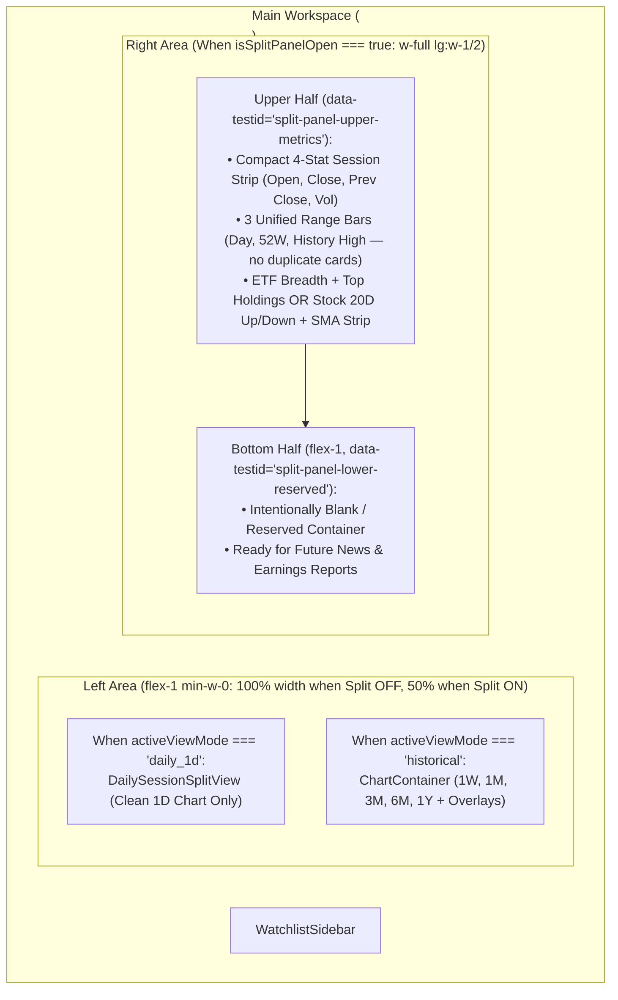

# Vertical Slice Specification: Milestone 19 — De-Duplicated Split Panel, Reserved Bottom Half for News/Earnings & Cross-Scope Ephemeral Toggle (`milestone-19-clean-toggleable-split-panel`)

## 1. Slice Scope & Architectural Invariants Check

### 1.1 Problem Statement & UX Goals
1. **Eliminate Duplicated Numbers & Redundant Bars**:
   - In Milestone 18, the `1D` view had three overlapping layers of the same numbers:
     1. `TopHeaderBar` already displays the active ticker, current price, and daily change (`$price +change (+change%)`).
     2. The left `1D` chart pane repeated a 6-column `Open / Close / High / Low / Prev Close / Change` header strip.
     3. The right split panel rendered 4 top cards (`Open At`, `Close At`, `52-Week Range`, `History High`) **and** then repeated the exact same `Day Range`, `52-Week Range`, and `Historical Range` low/high numbers a second time in the range bars below the cards.
   - **Clean Display Solution (Every Metric Appears Once)**:
     - **Left `1D` Chart Pane**: Remove the redundant 6-column `Open / Close / High / Low / Prev Close / Change` strip from above the `1D` chart. Keep only a clean, single-line header (`Latest Trading Day (1D) • YYYY-MM-DD` and `"← Historical Chart"` button), letting the chart's `Prev Close` / `Open` reference lines and interactive hover crosshair speak for themselves.
     - **Right Split Panel (Upper Half)**: Replace the separate "4 Cards + 3 Range Bars" layout with a **unified, zero-duplication layout**:
       - **Row 1 — 4-Stat Session Strip (Point Metrics Only)**: `Open` (with overnight gap `%`), `Close` (with intraday `Open → Close` `%`), `Prev Close`, and `Volume` (with `vs 20D Avg` badge).
       - **Row 2 — 3 Unified Range Bars (Range Numbers + Visual Bar Combined)**: Each range (`Day Range`, `52-Week Range`, `History High`) is rendered **once** as a single compact row with `$low` on the left, the visual position bar in the middle, and `$high` (plus `% from High`) on the right.
       - **Row 3 — Compact Instrument Pulse**:
         - **For ETFs (`SPY`, `QQQ`, etc.)**: Single-row `▲ Went Up / • Flat / ▼ Went Down` breadth bar + compact inline Top 5 Holdings strip (`ticker`, `weight%`, `change%`).
         - **For Individual Stocks (`AAPL`, `NVDA`, etc.)**: Single-row `Last 20D: ▲ Up Days vs ▼ Down Days` bar + `14D ATR` swing + compact 3-pill `20D / 50D / 200D SMA` row.

2. **Leave the Bottom Half of the Split Panel Open for Future News & Earnings Reports**:
   - Because the de-duplicated metrics fit cleanly into the **upper half** (`data-testid="split-panel-upper-metrics"`) of the right split panel, the **bottom half** (`flex-1`, `data-testid="split-panel-lower-reserved"`) is intentionally left open as a clean, minimal reserved container for **News & Earnings Reports (Future Work)**.

3. **Make the Split Panel an Independent Toggle Across All Time Scopes (Default Hidden, Ephemeral Only)**:
   - Previously, the split panel was hard-coupled to the `1D` button and hidden on `1W`, `1M`, `3M`, `6M`, `1Y`.
   - **New Behavior**:
     - Add an independent **Split Panel Toggle** (`isSplitPanelOpen: boolean`) in `App.tsx`, **defaulting to `false` (not shown)** on launch.
     - **Ephemeral Only (No Database Persistence)**: `isSplitPanelOpen` lives exclusively in React memory (`useState(false)`). It is **never** saved to `IndexedDBStorageRepository` / `preferencesStore` and **never** synced to Firebase Cloud Sync.
     - **Works Across All Time Scopes (`1D`, `1W`, `1M`, `3M`, `6M`, `1Y`)**:
       - Toggling the split panel ON shows `<StockDetailSplitPanel />` on the right side (`50%` width on desktop) beside whichever chart mode is active on the left (`DailySessionSplitView` when on `1D`, or `ChartContainer` when on `1W`, `1M`, `3M`, `6M`, `1Y`).
       - Toggling the split panel OFF hides the right panel so the active chart (`1D` or `1W`–`1Y`) expands to `100%` full width.
       - Clicking `1D`, `1W`, `1M`, `3M`, `6M`, `1Y` (or switching stocks in the watchlist) preserves the current `isSplitPanelOpen` toggle state.

---

### 1.2 Architectural Invariants Check
- [x] **Zero DOM/UI imports in `src/core/`**: Confirmed. `src/core/schemas/market.ts` and `src/core/serialization/workspaceExport.ts` remain 100% pure TypeScript + Zod. `isSplitPanelOpen` is ephemeral UI state and is not added to `UserPreferencesSchema` or `StorageRepository`.
- [x] **All external market data flows through `MarketDataProvider`**: Confirmed. `StockDetailSplitPanel` consumes `buildTickerDetailedReport` computed purely from normalized `OHLCVCandle[]` and `TickerQuote` records.
- [x] **All chart overlays use logical `{ timestamp, price }` coordinates and register via `ChartOverlayPlugin`**: Confirmed. When `isSplitPanelOpen` toggles on/off, `ChartContainer`'s `ResizeObserver` automatically resizes the TradingView canvas and re-projects all logical `{ timestamp, price }` overlays without losing zoom/pan scope.

---

## 2. Headless Core Contracts (`src/core/`)

### 2.1 Existing `buildTickerDetailedReport` Contract (`src/core/schemas/market.ts`)
No breaking changes are required in `src/core/schemas/market.ts`. `TickerDetailedReportSchema` and `buildTickerDetailedReport` already provide all required numbers (`open`, `close`, `previousClose`, `overnightGapPercent`, `openToCloseChangePercent`, `volume`, `relativeVolume`, `dayRange`, `week52Range`, `historyRange`, `historyHigh`, `movingAverages`, `etfBreadth`, and `stockPulse`).

### 2.2 Ephemeral Toggle Invariant (Zero Persistence in `src/core/schemas/preferences.ts`)
- Confirm that `UserPreferencesSchema` and `WorkspaceBackupSchema` do **not** include `isSplitPanelOpen`, guaranteeing that toggling the right split panel never writes to IndexedDB, never marks the workspace `isDirty`, and never triggers a Firebase Cloud Sync push.

---

## 3. UI & Chart Plugin Layer (`src/features/` & `src/ui/`)

### 3.1 Architecture of the Toggleable Split Layout



### 3.2 Split Panel Toggle Button in `TopHeaderBar` (`src/ui/layout/TopHeaderBar.tsx`)
1. **Props Extension (`TopHeaderBarProps`)**:
   - Add optional props (preserving all existing props and hook order indices `1..5`):
     ```typescript
     isSplitPanelOpen?: boolean;
     onToggleSplitPanel?: () => void;
     ```
2. **Toggle Button Rendering**:
   - Render a clean toggle button right next to the timeframe selector group whenever `onToggleSplitPanel` is provided (or always in the header bar with `data-testid="toggle-split-panel-btn"` when `onToggleSplitPanel` is passed):
     ```tsx
     {onToggleSplitPanel && (
       <button
         type="button"
         data-testid="toggle-split-panel-btn"
         aria-pressed={isSplitPanelOpen}
         onClick={onToggleSplitPanel}
         title="Toggle Stock Info Split Panel (i)"
         className={`flex items-center gap-1.5 rounded-lg border px-2.5 py-1.5 font-mono text-xs font-semibold transition ${
           isSplitPanelOpen
             ? 'border-emerald-500/50 bg-emerald-500/15 text-emerald-300'
             : 'border-slate-800 bg-slate-950 text-slate-400 hover:border-slate-700 hover:text-white'
         }`}
       >
         {isSplitPanelOpen ? (
           <PanelRightClose className="h-3.5 w-3.5 text-emerald-400" />
         ) : (
           <PanelRightOpen className="h-3.5 w-3.5" />
         )}
         <span className="hidden sm:inline">Info</span>
       </button>
     )}
     ```

### 3.3 De-Duplicated Right Split Panel & Clean `1D` Chart (`src/features/chart/DailySessionSplitView.tsx`)
1. **Extract Reusable `<StockDetailSplitPanel />` + Support Standalone or Integrated Rendering**:
   - Export `StockDetailSplitPanel` from `src/features/chart/DailySessionSplitView.tsx`:
     ```typescript
     export interface StockDetailSplitPanelProps {
       ticker: string;
       dailyCandles: OHLCVCandle[];
       intradayCandles?: OHLCVCandle[];
       quote?: TickerQuote;
       quotesByTicker?: Record<string, TickerQuote>;
       onClose?: () => void;
     }
     ```
   - Update `DailySessionSplitViewProps` to include `showSplitPanel?: boolean` (defaulting to `true` when rendered directly in isolated unit tests, and controlled by `isSplitPanelOpen` from `App.tsx`) and `onToggleSplitPanel?: () => void`:
     ```typescript
     export interface DailySessionSplitViewProps {
       ticker: string;
       dailyCandles: OHLCVCandle[];
       intradayCandles?: OHLCVCandle[];
       quote?: TickerQuote;
       quotesByTicker?: Record<string, TickerQuote>;
       isLoading?: boolean;
       showSplitPanel?: boolean;
       onToggleSplitPanel?: () => void;
       onBackToHistoricalChart?: () => void;
     }
     ```
2. **Clean Left `1D` Chart Pane (`data-testid="daily-1d-chart-pane"`)**:
   - Remove the duplicated 6-column `Open / Close / High / Low / Prev Close / Change` metrics bar from above the `1D` SVG chart (`TopHeaderBar` already shows the live quote/change, and the split panel shows the session numbers).
   - Keep only the single-line header (`{ticker}`, `Latest Trading Day (1D)`, `{YYYY-MM-DD}`, and the `"← Historical Chart"` return button `data-testid="daily-1d-back-btn"`).
   - When `showSplitPanel` is `false`, `daily-1d-chart-pane` takes `w-full flex-1`; when `showSplitPanel` is `true`, it takes `w-full lg:w-1/2`.
3. **De-Duplicated Right Split Panel (`data-testid="daily-1d-report-pane"`)**:
   - **Compact Header Bar**:
     - Left: `{report.ticker}`, `{report.name} • {report.exchange}`, and `STOCK` / `ETF` badge (`data-testid="daily-1d-instrument-badge"`).
     - Right: Optional close button (`data-testid="close-split-panel-btn"`) when `onClose` is provided.
   - **Upper Half — Compact, Zero-Duplication Metrics (`data-testid="split-panel-upper-metrics"` & `data-testid="daily-1d-key-numbers-section"`)**:
     - **A. 4-Column Point Metrics Strip** (no range duplication):
       1. `Open` (`data-testid="daily-1d-report-open-card"` / `data-testid="daily-1d-open"`): `$open` + `Gap +X.XX%`
       2. `Close` (`data-testid="daily-1d-report-close-card"` / `data-testid="daily-1d-close"`): `$close` + `Intraday +X.XX%`
       3. `Prev Close` (`data-testid="daily-1d-prev-close"`): `$previousClose` + `Day Change` (`data-testid="daily-1d-change"`)
       4. `Volume`: `XX.XM` + `${relativeVolume}x Avg` badge
     - **B. 3 Unified Range Bars** (each range appears **once**, combining the low/high numbers and visual progress bar in a single compact row):
       1. `Day Range`: Low `$low` (`data-testid="daily-1d-low"`) ── `[Progress Bar]` ── High `$high` (`data-testid="daily-1d-high"`) (`{positionPercent}%`)
       2. `52-Week Range` (`data-testid="daily-1d-report-52w-card"`): `$52wLow` ── `[Progress Bar]` ── `$52wHigh` (`{distanceFromHighPercent}% from High`)
       3. `History High` (`data-testid="daily-1d-report-history-high-card"`): `$histLow` ── `[Progress Bar]` ── `$historyHigh` (`{distanceFromHighPercent}% from Peak`)
     - **C. Compact Instrument Pulse & Trend Strip (`data-testid="daily-1d-horizon-trend-section"`)**:
       - **When ETF (`report.instrumentType === 'etf'`, `data-testid="daily-1d-etf-breadth-section"`)**:
         - Single-row constituent breadth header + stacked bar: `▲ {advancingCount} Up ({advancingPercent}%)` (`data-testid="daily-1d-etf-up-count"`), `• {unchangedCount} Flat`, `▼ {decliningCount} Down ({decliningPercent}%)` (`data-testid="daily-1d-etf-down-count"`).
         - Compact Top Holdings strip (`data-testid="daily-1d-etf-top-holdings"`): 5 inline pills/rows showing `{ticker} {weightPercent}% ({changePercent}%)`.
       - **When Stock (`report.instrumentType === 'stock'`, `data-testid="daily-1d-stock-pulse-section"`)**:
         - Single-row 20-Day Up/Down bar: `Last 20D:` `▲ {upDaysCount} Up` (`data-testid="daily-1d-stock-up-days"`) / `▼ {downDaysCount} Down` (`data-testid="daily-1d-stock-down-days"`) + `14D ATR: $${atr14} ({atr14Percent}%)` + `{closeStrengthLabel}`.
       - **Compact 3-Pill Moving Average Row (`20D SMA`, `50D SMA`, `200D SMA`)**: Shows `$price` and `Above` / `Below` (`+X.X%`).
   - **Bottom Half — Reserved Space for Future News & Earnings (`data-testid="split-panel-lower-reserved"`)**:
     - Occupies the remaining bottom half (`flex-1 min-h-[180px] flex flex-col rounded-xl border border-dashed border-slate-800/70 bg-slate-900/20 p-4`) with a clean header (`News & Earnings Reports • Future Work`) so the bottom half of the panel remains visually open and uncluttered.

### 3.4 Cross-Scope Split Panel Wiring in `src/App.tsx`
1. Add ephemeral state in `src/App.tsx`:
   ```typescript
   const [isSplitPanelOpen, setIsSplitPanelOpen] = useState(false);
   ```
   - Default is `false` (hidden on launch).
   - Never persisted to `preferencesStore` or `IndexedDBStorageRepository`.
2. Add keyboard shortcut `i` in `handleKeyDown` (when not editing an input and no modifier keys pressed):
   ```typescript
   if (keyLower === 'i') {
     e.preventDefault();
     setIsSplitPanelOpen((prev) => !prev);
     return;
   }
   ```
3. Pass `isSplitPanelOpen={isSplitPanelOpen}` and `onToggleSplitPanel={() => setIsSplitPanelOpen((prev) => !prev)}` to `TopHeaderBar`.
4. In `<main className="relative flex flex-1 overflow-hidden">`:
   - Render the active chart on the left (`flex-1 min-w-0`):
     - When `activeViewMode === 'daily_1d'`, render `<DailySessionSplitView showSplitPanel={false} ... />` (or let the shared right panel render beside it when `isSplitPanelOpen === true`).
     - When `activeViewMode === 'historical'`, render `<ChartContainer ... />` inside a `flex-1 min-w-0` container.
   - Whenever `isSplitPanelOpen === true` (across **any** timeframe: `1D`, `1W`, `1M`, `3M`, `6M`, `1Y`), render `<StockDetailSplitPanel ticker={activeTicker} dailyCandles={activeCandles} intradayCandles={activeIntradayCandles} quote={activeQuote} quotesByTicker={quotesByTicker} onClose={() => setIsSplitPanelOpen(false)} />` on the right half (`w-full lg:w-1/2 border-l border-slate-800/80`)!

---

## 4. Ordered File Manifest

1. `[MODIFY]` [TopHeaderBar.tsx](file:///home/duke/Project/marketview/src/ui/layout/TopHeaderBar.tsx)
   - Add `isSplitPanelOpen?: boolean` and `onToggleSplitPanel?: () => void` props and render the `data-testid="toggle-split-panel-btn"` toggle button beside the timeframe selector.
2. `[MODIFY]` [DailySessionSplitView.tsx](file:///home/duke/Project/marketview/src/features/chart/DailySessionSplitView.tsx)
   - Remove the duplicated 6-column session metrics strip from the left `1D` chart pane.
   - Refactor the right panel into `<StockDetailSplitPanel />` with:
     - **Upper Half (`data-testid="split-panel-upper-metrics"`)**: Unified 4-stat session strip + 3 single-line range bars (no duplicate 52W/History cards + bars) + compact ETF breadth / Stock 20D pulse.
     - **Bottom Half (`data-testid="split-panel-lower-reserved"`)**: Clean reserved space for future News & Earnings Reports.
   - Support `showSplitPanel?: boolean` on `DailySessionSplitView`.
3. `[MODIFY]` [App.tsx](file:///home/duke/Project/marketview/src/App.tsx)
   - Add ephemeral `isSplitPanelOpen` state (default `false`, never persisted to DB/Cloud Sync), wire keyboard shortcut `i` and `TopHeaderBar` toggle button, and render `<StockDetailSplitPanel />` beside both `ChartContainer` (`1W`–`1Y`) and `DailySessionSplitView` (`1D`) whenever `isSplitPanelOpen` is `true`.
4. `[MODIFY]` [KeyboardShortcutsPopover.tsx](file:///home/duke/Project/marketview/src/ui/shortcuts/KeyboardShortcutsPopover.tsx)
   - Document `i` (`Toggle Stock Info split panel`) in the keyboard shortcuts list.
5. `[MODIFY]` [daily-session-split-view.test.ts](file:///home/duke/Project/marketview/src/features/chart/__tests__/daily-session-split-view.test.ts)
   - Test the de-duplicated upper half (`data-testid="split-panel-upper-metrics"`), the reserved bottom half for future News & Earnings (`data-testid="split-panel-lower-reserved"`), `showSplitPanel={false}` hiding the panel on `1D`, and `TopHeaderBar`'s `data-testid="toggle-split-panel-btn"` across timeframes.

---

## 5. Verification & Test Matrix

1. **Zero Duplication & Reserved Bottom Half UI Tests (`src/features/chart/__tests__/daily-session-split-view.test.ts`)**:
   - Verify `DailySessionSplitView` left chart pane no longer renders a duplicate 6-column session strip when the split panel is closed (`showSplitPanel={false}`), and when open (`showSplitPanel={true}`) each metric (`Open`, `Close`, `52-Week Range`, `History High`) is rendered in a single unified row without duplicate cards + bars.
   - Verify `StockDetailSplitPanel` renders both `data-testid="split-panel-upper-metrics"` (upper half) and `data-testid="split-panel-lower-reserved"` (bottom half reserved for future News & Earnings Reports).
2. **Cross-Scope Ephemeral Toggle Tests (`src/features/chart/__tests__/daily-session-split-view.test.ts`)**:
   - Verify `TopHeaderBar` renders `data-testid="toggle-split-panel-btn"` with `aria-pressed="false"` by default and `aria-pressed="true"` when `isSplitPanelOpen={true}`.
   - Verify `UserPreferencesSchema` and `WorkspaceBackupSchema` do not persist `isSplitPanelOpen`.
3. **Full Typecheck & Test Suite**:
   - `npm run typecheck` (`tsc --noEmit`) passes with zero errors.
   - `npm run test` (`vitest run`) passes all 38 test suites with zero regressions.
