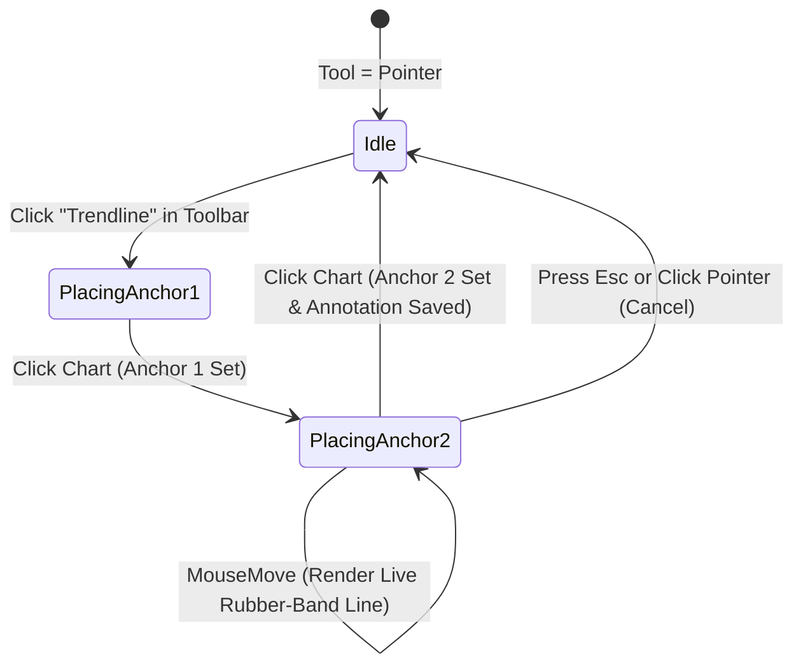

# Vertical-Slice Specification: Milestone 3 — Interactive Trendline Drawing Tool

## 1. Slice Scope & Architectural Invariants Check

### In-Scope Deliverables
1. **Headless Core Schemas (`src/core/schemas/annotation.ts`)**:
   - `TrendlinePayloadSchema`: color, lineWidth, lineStyle (`solid` | `dashed`), extendRight (ray extension), and showLabel.
   - Zero DOM/UI dependencies; schema validated in headless core tests.
2. **Multi-Anchor Overlay Interaction Engine (`src/features/chart/overlays/OverlayCanvas.tsx`)**:
   - Generalize `OverlayCanvas` to support multi-anchor tool placement workflows (`requiredAnchors: 2` for trendlines vs `1` for stickers).
   - Real-time rubber-band draft preview when `draftAnchors.length === 1` connecting the initial logical anchor to the live mouse pointer coordinate.
   - Dynamic SVG projection for vector lines across pan/zoom revisions without mutating stored logical anchors.
3. **Trendline Plugin (`src/features/chart/overlays/plugins/TrendlinePlugin.tsx`)**:
   - Implements `ChartOverlayPlugin<TrendlinePayload>` (`type: 'trendline'`, `requiredAnchors: 2`).
   - Projects two logical `{ timestamp, price }` anchors to SVG coordinates.
   - Two draggable circular anchor handles allowing fine-grained repositioning of start and end points.
   - Line-body dragging to translate both anchors simultaneously.
   - Floating metric badge displaying slope, `ΔPrice`, `Δ%`, and time/bar delta.
   - Inline formatting toolbar on selection (color picker, solid/dashed toggle, extend-ray toggle, delete).
4. **Chart Toolbar Update (`src/features/chart/overlays/ChartToolbar.tsx`)**:
   - Add `Trendline` drawing tool button alongside `Pointer` and `Sticker Note`.
5. **Automated Verification**:
   - Unit tests in `src/core/__tests__/trendline-schema.test.ts` verifying anchor constraints (minimum 2 anchors for trendline type) and payload validation.
   - Boundary checks in `src/core/__tests__/architecture-boundaries.test.ts` ensuring clean separation.

### Architectural Invariants Verification
- [x] **Zero DOM/UI Imports in `src/core/`**: All trendline schemas remain in `src/core/schemas/` without DOM or React imports.
- [x] **Open-Closed Principle for Chart Customizations**: Base `ChartContainer.tsx` is NOT modified; `TrendlinePlugin` registers cleanly through `overlayPluginRegistry`.
- [x] **Logical Coordinate Contract**: Both start and end points are stored strictly as logical `{ timestamp: number, price: number }`. Viewport `(x, y)` pixel lines are projected dynamically via `projector.logicalToScreen`.

---

## 2. Headless Core Contracts (`src/core/`)

### 2.1 Trendline Payload Schema (`src/core/schemas/annotation.ts`)
```typescript
import { z } from 'zod';

export const TrendlineStyleSchema = z.enum(['solid', 'dashed']);
export type TrendlineStyle = z.infer<typeof TrendlineStyleSchema>;

export const TrendlinePayloadSchema = z.object({
  color: z.string().default('#38bdf8'),
  lineWidth: z.number().min(1).max(6).default(2),
  lineStyle: TrendlineStyleSchema.default('solid'),
  extendRight: z.boolean().default(false),
  showLabel: z.boolean().default(true),
});
export type TrendlinePayload = z.infer<typeof TrendlinePayloadSchema>;
```

### 2.2 Validation Invariant for Trendlines
`ChartAnnotationSchema` already enforces `anchors: z.array(LogicalAnchorSchema).min(1)`. For trendline annotations, `TrendlinePlugin.requiredAnchors === 2`, and unit tests will verify that trendline instances contain exactly 2 logical anchors:
- `anchors[0]`: Start `{ timestamp: number, price: number }`
- `anchors[1]`: End `{ timestamp: number, price: number }`

---

## 3. UI & Chart Plugin Layer (`src/features/` & `src/ui/`)

### 3.1 Multi-Anchor Draft Interaction Workflow (`OverlayCanvas.tsx`)


1. **State**: `draftAnchors: LogicalAnchor[]`.
2. **First Click**: When `activeTool === 'trendline'` and `draftAnchors.length === 0`, click projects screen point to `anchor1`, setting `draftAnchors = [anchor1]`.
3. **Draft Preview**: While moving the mouse, `activePlugin.renderDraftPreview` renders an SVG vector from `projector.logicalToScreen(anchor1)` to `mousePoint`.
4. **Second Click**: Click projects screen point to `anchor2`, sets `anchors = [anchor1, anchor2]`, calls `onAddAnnotation(...)`, clears `draftAnchors`, and returns `activeTool` to `null`.

### 3.2 Trendline Vector Projection & Interactive Controls (`TrendlinePlugin.tsx`)
- Projects `anchor1` to `p1 = { x1, y1 }` and `anchor2` to `p2 = { x2, y2 }`.
- If `extendRight === true`, computes ray intersection with canvas right edge `x = width`:
  $$y_{\text{edge}} = y_1 + \frac{y_2 - y_1}{x_2 - x_1} \times (\text{width} - x_1)$$
- Renders SVG `<line>` with an invisible `<line strokeWidth={16}>` hitbox for easy selection and click-to-edit.
- Displays calculated metrics banner:
  - $\Delta \text{Price} = \text{price}_2 - \text{price}_1$
  - $\Delta \% = \left(\frac{\text{price}_2 - \text{price}_1}{\text{price}_1}\right) \times 100$
- Renders drag handles for `anchor1` and `anchor2` allowing dynamic logical coordinate modification.
- Contextual formatting bar appears above the trendline when selected:
  - Quick color switcher (`#38bdf8` sky, `#10b981` emerald, `#f59e0b` amber, `#f43f5e` rose, `#a855f7` purple)
  - Style switcher (`Solid` / `Dashed`)
  - Ray toggle (`Extend Right`)
  - Delete button

---

## 4. Ordered File Manifest

1. `[MODIFY] src/core/schemas/annotation.ts` — Add `TrendlineStyleSchema` and `TrendlinePayloadSchema`.
2. `[NEW] src/core/__tests__/trendline-schema.test.ts` — Unit tests verifying trendline payload defaults, custom overrides, and 2-anchor logical structures.
3. `[MODIFY] src/features/chart/overlays/OverlayCanvas.tsx` — Add `draftAnchors` state to support multi-anchor tools (such as 2-anchor trendlines) alongside single-anchor tools (stickers).
4. `[NEW] src/features/chart/overlays/plugins/TrendlinePlugin.tsx` — Implementation of `ChartOverlayPlugin<TrendlinePayload>` with SVG line rendering, ray extension, drag handles, and metric badges.
5. `[MODIFY] src/features/chart/overlays/ChartToolbar.tsx` — Add `Trendline` button with `TrendingUp` icon.
6. `[MODIFY] src/features/chart/overlays/OverlayCanvas.tsx` — Import `./plugins/TrendlinePlugin` to auto-register.

---

## 5. Verification & Test Matrix

| Check ID | Target | Verification Command | Acceptance Criteria |
| :--- | :--- | :--- | :--- |
| **TC-M3-01** | PostToolUse Hook & Types | `npm run typecheck` (`tsc --noEmit`) | Zero TypeScript errors across all trendline plugins, schemas, and canvas components. |
| **TC-M3-02** | Core Isolation | `npx vitest run src/core/__tests__/architecture-boundaries.test.ts` | All files in `src/core/**` remain completely free of UI/DOM imports. |
| **TC-M3-03** | Trendline Schema & Anchors | `npx vitest run src/core/__tests__/trendline-schema.test.ts` | `TrendlinePayloadSchema` validates color/style options and round-trips via `ChartAnnotationSchema` with 2 logical anchors. |
| **TC-M3-04** | Rubber-Band & Ray Projection | Browser / Unit verification | Multi-anchor draft workflow displays live rubber-band preview on mouse move; placed trendline maintains exact logical slope during chart zoom and pan. |
| **TC-M3-05** | Production Build | `npm run build` | Clean Vite production build. |
